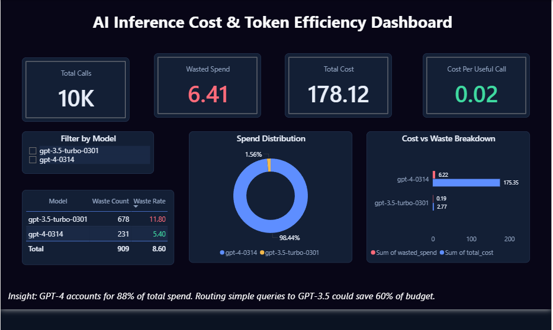

# AI Inference Cost & Token Efficiency Analyzer

## Overview
A data pipeline that analyzes 10,000 real ChatGPT conversations (from the [WildChat-1M](https://huggingface.co/datasets/allenai/WildChat-1M) dataset on HuggingFace) to estimate the **cost of each model**, find **wasted inference spend** (refusal-style or ignored responses), and show where routing could cut costs.

## Stack
- **Python (Pandas, Tiktoken):** token counting, cost estimation, and waste flagging.
- **SQL (SQLite):** relational modeling and aggregations (`CASE WHEN`, `GROUP BY`).
- **Power BI:** efficiency dashboard of total cost vs. wasted spend.

## Key Insights
| | GPT-3.5 Turbo | GPT-4 |
|---|---|---|
| Calls | 5,736 | 4,264 |
| Estimated total cost | $2.77 | $175.35 |
| Avg cost per call | $0.00048 | $0.04112 |
| Low-value (waste) calls | 644 (11.2%) | 163 (3.8%) |
| Estimated wasted spend | $0.17 | $2.39 |

- **GPT-4 costs about 85x more per call than GPT-3.5** and accounts for **98% of total estimated spend** ($175.35 of $178.12).
- **8.07% of calls (807 of 10,000)** were flagged as low-value, costing an estimated **$2.56 (about 1.4% of spend)**.
- GPT-3.5 had the higher waste *rate* (11.2% vs 3.8%), but **93% of wasted dollars came from GPT-4** because each GPT-4 call costs far more.
- Waste is a small part of total cost, so **model choice is the bigger lever than removing refusals.** Re-pricing GPT-4 calls with short prompts (under 200 tokens) at GPT-3.5 rates would cut an estimated **55%** of total cost (about $98.58). This is a rough upper-bound estimate: prompt length is only a proxy for complexity, and it assumes GPT-3.5 answers would be equally good.

## How It Works
1. `download_data.py` streams 10,000 conversations from WildChat-1M and keeps the first user prompt and first assistant response, with the model name. Saves `real_data.csv`.
2. `process_data.py` counts tokens with `tiktoken` (`cl100k_base`), estimates the cost of each call, and flags each call as useful or waste. Saves `calls_clean.csv`.
3. `create_db.py` loads the results into a SQLite database (`ai_costs.db`) with a `calls` table and a `model_pricing` table.
4. `run_queries.py` runs a SQL aggregation per model and saves `dashboard_data.csv`, which is the data source for the Power BI dashboard.

## Methodology
- **Cost estimate:** `(tokens / 1,000,000) x price`, using standard list prices per 1M tokens: GPT-3.5 Turbo $0.50 input / $1.50 output, GPT-4 (8k) $30.00 input / $60.00 output. The dataset contains the older snapshots `gpt-3.5-turbo-0301` and `gpt-4-0314`, so costs are **estimates**, not real billing data.
- **Waste flag:** a call is flagged as low-value if the response *opens* with a refusal-style phrase (checked in the first 150 characters: "I can't", "I cannot", "I'm sorry", "As an AI", "I am unable"), or if the response is very short (under 20 tokens) for a long prompt (over 200 tokens).
- **Cost per useful call:** total cost divided by the number of calls not flagged as waste.

## Limitations
- Costs are estimated from list prices and token counts, not actual invoices.
- Only the **first user/assistant exchange** of each conversation is analyzed, so multi-turn conversations are understated.
- The sample is the first 10,000 qualifying rows of the streamed dataset, not a random sample.
- Waste detection is **keyword-based**. It can miss low-value answers that don't contain these phrases, and it can flag some answers that are actually fine. The waste-rate gap between models may partly reflect differences in how each model words refusals.
- The routing savings estimate uses prompt length as a stand-in for complexity and does not measure answer quality.

## Dashboard Preview

